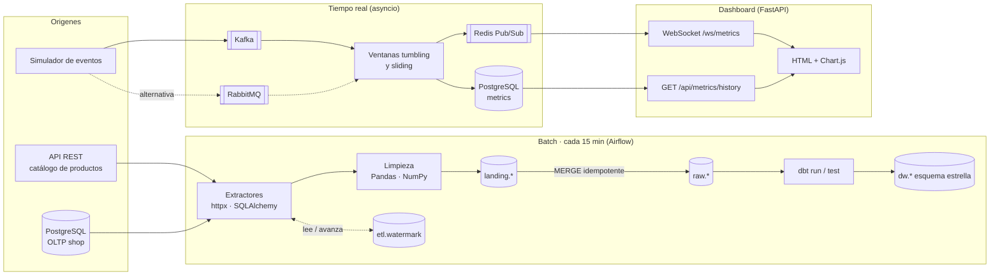
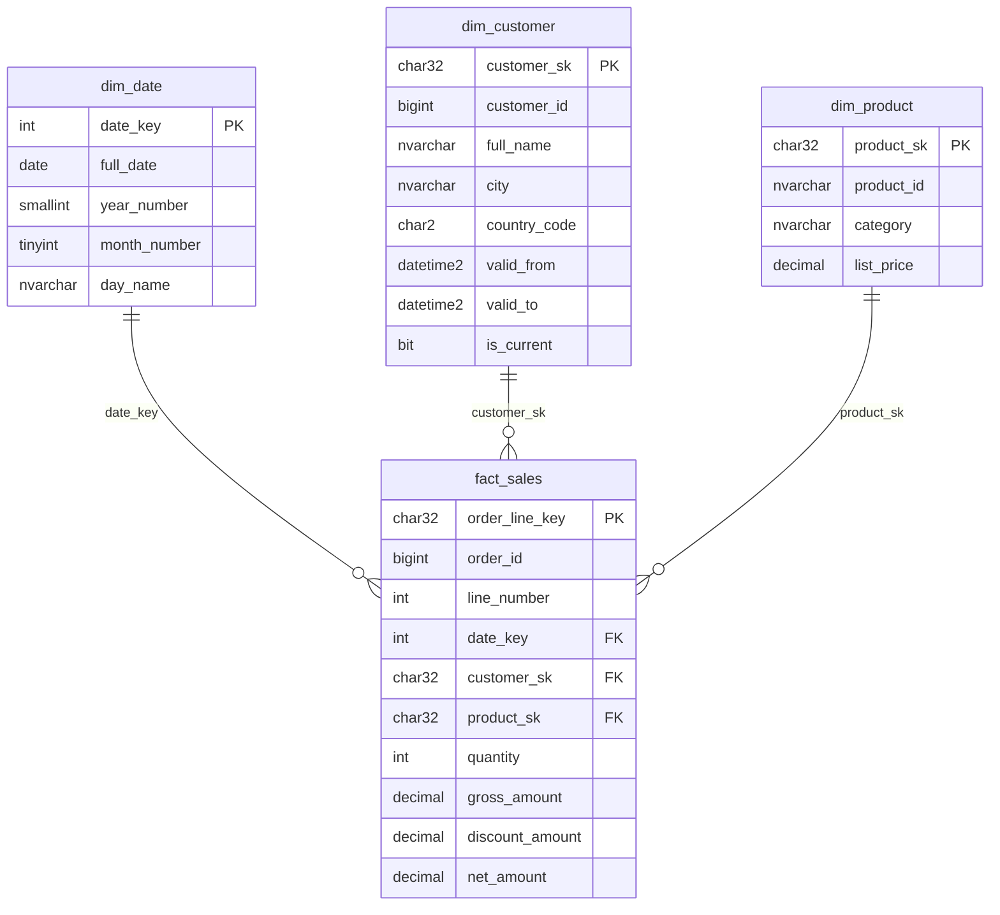

# Data Warehouse Pipeline · batch + tiempo real

Pipeline de datos con dos caminos que comparten infraestructura:

- **Batch**: ingesta incremental desde una API REST y una base transaccional hacia un Data Warehouse en **SQL Server** con modelo dimensional (esquema estrella, Kimball). Orquestado con **Airflow** y modelado con **dbt**.
- **Tiempo real**: consumo de un flujo de eventos de ventas (**Kafka** o **RabbitMQ**), cálculo de métricas por ventanas de tiempo con **asyncio** + **NumPy**, publicación en un dashboard en vivo vía **Redis Pub/Sub** + **WebSockets** y persistencia de históricos en **PostgreSQL**.

**Stack**: Python, asyncio, Pandas, NumPy, SQLAlchemy, Apache Kafka, RabbitMQ, Redis Pub/Sub, Airflow, dbt, FastAPI, WebSockets, PostgreSQL, SQL Server, Docker.

---

## Arquitectura



### Modelo dimensional



- **Grano del hecho**: una fila por línea de pedido (`order_id`, `line_number`).
- **dim_customer**: SCD tipo 2 (historial de ciudad, país, segmento).
- **dim_product**: SCD tipo 1 (se sobreescribe, el precio histórico queda en el hecho).
- **dim_date**: calendario generado, clave `yyyymmdd`, nombres en castellano y semana ISO.

---

## Estructura del repo

```
├── airflow/dags/            DAG extract_load -> dbt freshness -> dbt run -> dbt test
├── batch/
│   ├── extractors/          API REST (paginación + reintentos) y base transaccional (SQLAlchemy)
│   ├── entities.py          catálogo de entidades: origen, clave natural, columnas, transformación
│   ├── transform.py         limpieza con Pandas/NumPy, deduplicación y row_hash
│   ├── watermark.py         ventanas de extracción incremental y estado en etl.watermark
│   ├── sql_builder.py       generación del MERGE landing -> raw
│   ├── loader.py            carga a landing (fast_executemany) y MERGE
│   └── run.py               CLI: python -m batch.run --entity customers
├── dbt/
│   ├── models/staging/      sources + vistas stg_*
│   ├── models/marts/        dim_date, dim_customer (SCD2), dim_product, fact_sales (incrementales)
│   ├── macros/              surrogate_key, high watermark incremental, nombres de esquema
│   └── tests/               tests genéricos y singulares (SCD2 sin solapamientos, montos consistentes)
├── streaming/
│   ├── consumers/           interfaz EventConsumer + implementaciones Kafka y RabbitMQ
│   ├── windows.py           agregación tumbling / sliding con watermark de event time
│   ├── pipeline.py          loop asyncio: consumo, cierre de ventanas, publicación, commit
│   ├── publisher.py         Redis Pub/Sub
│   ├── storage.py           históricos en PostgreSQL (upsert idempotente)
│   ├── simulator.py         generador determinístico de eventos
│   └── producer.py          producer a Kafka o RabbitMQ
├── dashboard/               FastAPI: WebSocket, REST de históricos y página estática
├── mock_sources/            API de productos y simulador de actividad OLTP
├── sql/
│   ├── sqlserver/           DDL: esquemas, watermark, landing/raw, estrella, miembros desconocidos
│   └── postgres/            bases shop / metrics / airflow
├── tests/                   tests unitarios de lógica pura
├── docker/                  Dockerfiles y script de init de SQL Server
├── docker-compose.yml
└── Makefile
```

---

## Cómo correrlo

### Requisitos

- Docker y Docker Compose v2
- ~6 GB de RAM libres (SQL Server solo ya pide 2 GB)
- Python 3.11+ para correr los tests en local

### Stack completo

```bash
cp .env.example .env        # cambiar MSSQL_PASSWORD si hace falta (mínimo 8 caracteres, complejidad de SQL Server)
make up                     # o: docker compose up -d --build
make ps
```

| Servicio | URL |
|---|---|
| Dashboard en vivo | http://localhost:8000 |
| Docs de la API del dashboard | http://localhost:8000/docs |
| Airflow | http://localhost:8080 (admin / `AIRFLOW_ADMIN_PASSWORD`) |
| RabbitMQ management | http://localhost:15672 (guest / guest) |
| API de productos (mock) | http://localhost:8001/docs |
| SQL Server | `localhost,1433` (sa / `MSSQL_PASSWORD`) |

Al levantar:

1. `sqlserver-init` aplica el DDL de `sql/sqlserver` en orden.
2. Postgres crea las bases `shop`, `metrics` y `airflow`.
3. `oltp-simulator` genera clientes y pedidos, y modifica clientes cada tanto (eso dispara nuevas versiones SCD2).
4. `event-producer` publica ~25 eventos/s y `stream-processor` empieza a emitir ventanas. El dashboard se actualiza solo.
5. El DAG `dwh_batch_pipeline` corre cada 15 minutos. Para no esperar se puede disparar desde la UI o con `make batch dbt-run dbt-test`.

Para usar RabbitMQ en lugar de Kafka:

```bash
make rabbitmq-mode          # STREAM_BROKER=rabbitmq docker compose up -d --force-recreate event-producer stream-processor
```

### Consultas de ejemplo en el DW

```sql
-- Ventas netas por mes y segmento, con el segmento que tenía el cliente al momento de la compra
SELECT d.year_number, d.month_name, c.segment, SUM(f.net_amount) AS net_sales
FROM dw.fact_sales f
JOIN dw.dim_date d     ON d.date_key = f.date_key
JOIN dw.dim_customer c ON c.customer_sk = f.customer_sk
GROUP BY d.year_number, d.month_number, d.month_name, c.segment
ORDER BY d.year_number, d.month_number;

-- Historial de un cliente
SELECT customer_id, city, segment, valid_from, valid_to, is_current
FROM dw.dim_customer WHERE customer_id = 42 ORDER BY valid_from;
```

### Tests

Los tests unitarios cubren la lógica pura (ventanas, transformaciones, watermark, MERGE, pipeline con dobles en memoria) y no necesitan infraestructura ni los clientes de Kafka/RabbitMQ/Redis.

```bash
python -m venv .venv
# Linux/macOS: source .venv/bin/activate   ·   Windows: .venv\Scripts\activate
pip install -r requirements-dev.txt
pytest
```

Los tests de datos sobre el DW (unicidad, integridad referencial, SCD2 sin solapamientos, consistencia de montos) son tests de dbt y corren en `dbt test`.

---

## Decisiones de diseño

### Batch

**Capas landing → raw → staging → dw.** `landing` es una copia efímera del lote (truncate + insert con `fast_executemany`), `raw` guarda el estado actual de cada entidad de origen y es la `source` de dbt. Separar landing de raw permite que el MERGE sea un único statement set-based y que un lote fallido no deje raw a medio escribir.

**Carga incremental por watermark con solapamiento.** Cada entidad extrae el intervalo `(watermark - lookback, now - safety_lag]` sobre `updated_at`.
- El *lookback* cubre transacciones que commitean tarde con un `updated_at` anterior al watermark.
- El *safety lag* evita leer transacciones todavía abiertas.
- El watermark avanza al máximo `updated_at` extraído (nunca retrocede y nunca supera el límite superior de la ventana) y se guarda **en la misma transacción que el MERGE**: si la carga falla, el retry arranca desde el último estado confirmado.
- Los duplicados del solapamiento se absorben porque el MERGE solo actualiza cuando la versión entrante es más nueva (`s.updated_at > t.updated_at`) y deduplica el origen con `ROW_NUMBER()`.

**Limpieza en Pandas, reglas de negocio en dbt.** Python normaliza tipos, textos, códigos de país, estados, acota valores imposibles con NumPy y calcula `row_hash`. Todo lo que es modelado dimensional (versionado, surrogate keys, lookups) vive en SQL versionado y testeado con dbt.

**DDL propio + dbt incremental.** Las tablas del DW se crean con DDL explícito (PKs, FKs, índice filtrado único para la versión vigente, columnstore en el hecho) y los modelos de dbt son `incremental` con estrategia `merge` y `on_schema_change: fail`. dbt nunca recrea las tablas salvo un `--full-refresh` explícito, y los índices y constraints quedan bajo control.

**SCD tipo 2 en dbt.** `dim_customer` compara el `row_hash` entrante contra la versión vigente. Por cada cambio emite la versión vigente cerrada y la nueva versión, y el MERGE por `customer_sk` actualiza una e inserta la otra. La primera versión arranca en `1900-01-01` para que las ventas previas a la primera extracción también encuentren cliente. Limitación conocida: si un cliente cambia dos veces entre corridas solo se registra el último estado, porque raw guarda la foto actual (para historial completo haría falta CDC).

**Surrogate keys por hash.** `MD5(clave natural [+ versión])` en `CHAR(32)`. Son determinísticas (mismo resultado en cualquier entorno o recarga) y permiten cargar dimensiones y hechos en paralelo sin depender de un `IDENTITY`.

**Miembros desconocidos y early arriving facts.** Si una venta llega antes que su cliente o producto se asigna el miembro desconocido (`000…0`). El hecho reprocesa con un lookback de 2 horas y el MERGE corrige la FK cuando la dimensión aparece.

**Airflow.** `max_active_runs=1` porque dos corridas simultáneas competirían por el mismo watermark. Las extracciones corren en paralelo, `dbt test` no se reintenta (un test que falla es un problema de datos, no transitorio).

### Tiempo real

**Interfaz de consumidor única.** `EventConsumer` abstrae `start/stop/events/commit`. Kafka y RabbitMQ se eligen por configuración (`STREAM_BROKER`) y sus librerías se importan de forma diferida, así el resto del código y los tests no dependen de ellas.

**Ventanas por event time con watermark.** Tumbling y sliding comparten implementación (una tumbling es una sliding con `step == size`). Una ventana se emite cuando `max(event_ts) - allowed_lateness` supera su fin; los eventos que llegan después se descartan y se cuentan en `late_events`. Un ticker cierra ventanas con el reloj de procesamiento cuando el flujo queda quieto, para que el dashboard no se congele.

**Métricas con NumPy.** Por ventana y por grupo (`all` + canal): count, sum, avg, min, max y p95 con `np.percentile`. Se guardan los valores crudos de cada ventana abierta, el costo de memoria es acotado porque las ventanas son cortas. Para ventanas largas o alto volumen convendría un sketch (t-digest) en lugar de valores exactos.

**Entrega at-least-once.** Los offsets/acks se confirman en lote después de persistir y publicar las ventanas cerradas. Si el proceso cae antes, el broker reentrega y el upsert en Postgres (`ON CONFLICT ... DO UPDATE` sobre la clave de la ventana) es idempotente. Trade-off asumido: los eventos de ventanas todavía abiertas al momento de una caída pueden perderse del agregado en vivo. Para estas métricas operativas es aceptable; la fuente de verdad de ventas es el DW.

**Redis Pub/Sub como bus en vivo.** El procesador publica cada ventana cerrada; el dashboard mantiene **una** suscripción por proceso y hace fan-out a los WebSockets. Cada cliente tiene una cola acotada: un navegador lento pierde mensajes viejos en vez de frenar a los demás. Si se escalan varias réplicas del dashboard, cada una se suscribe por su cuenta sin coordinación.

**Persistencia antes que publicación.** Primero se escribe en Postgres y después en Redis, así el histórico queda completo aunque Redis falle. Al conectarse, el WebSocket manda un snapshot de los últimos 15 minutos y después solo deltas.

---

## Configuración

Toda la configuración se lee de variables de entorno con `pydantic-settings` (`common/config.py`), agrupada por prefijo: `MSSQL_`, `SOURCE_DB_`, `SOURCE_API_`, `BATCH_`, `STREAM_`, `REDIS_`, `METRICS_DB_`. Ver `.env.example`.

## Próximos pasos

- CDC con Debezium sobre el OLTP para historial completo en SCD2 y borrados.
- Dead-letter queue explícita para eventos inválidos en Kafka.
- Tests de integración con Testcontainers (SQL Server, Kafka, Redis).
- Exponer métricas del pipeline (lag del consumidor, eventos tardíos, filas por corrida) en Prometheus.
